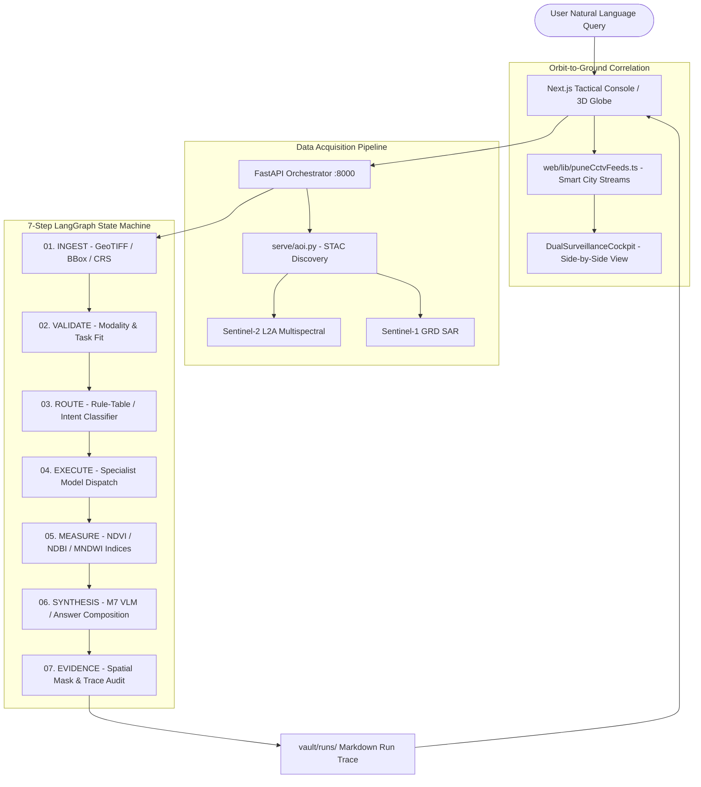

# SatQuery AI — System Architecture Specification

## Overview

SatQuery AI is an agentic vision-language assistant for multimodal remote sensing and earth observation. It couples spaceborne satellite observations (Sentinel-2 multispectral and Sentinel-1 SAR) with street-level ground surveillance feeds and an auditable execution trace.

## Key Architectural Principles

### 1. Measured, Not Hallucinated
- Quantitative land-cover percentages (e.g. built-up 37.6%, vegetation 14.2%, water 48.2%) are strictly computed directly from pixel reflectance values using validated spectral indices:
  - **NDVI** = $(NIR - RED) / (NIR + RED)$ (Vegetation vigor)
  - **MNDWI** = $(GREEN - SWIR) / (GREEN + SWIR)$ (Open water)
  - **NDBI** = $(SWIR - NIR) / (SWIR + NIR)$ (Built-up infrastructure)
- Models narrate and ground observations, but are barred from fabricating quantitative coverage metrics.

### 2. Multi-City Ground Correlation
- Satellite passes (10m GSD) are correlated with real-time ground CCTV surveillance camera streams at high-density transit choke points (Pune, Mumbai BKC, Bengaluru Silk Board, Delhi Connaught Place, Hyderabad HITEC City).

### 3. Auditable Execution Traces
- Every request produces an immutable run record with model IDs, parameter thresholds, execution latencies, and step outcomes saved to `vault/runs/<run_id>.md`.
